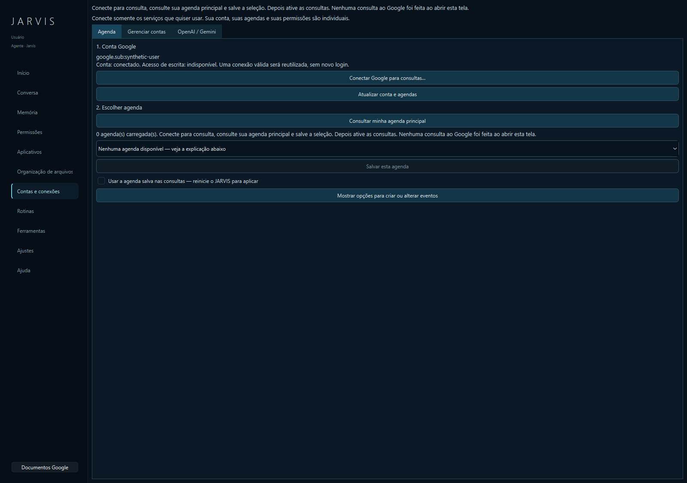
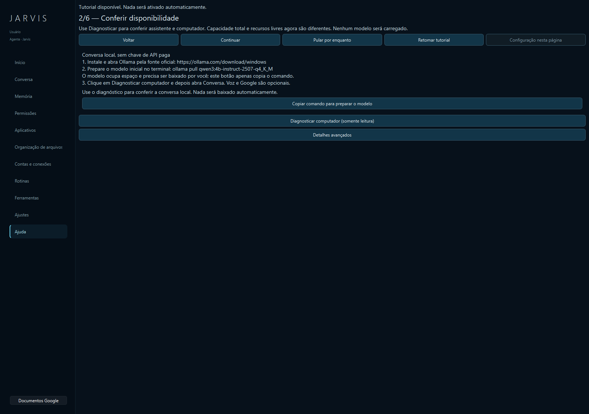

# Estado do JARVIS — revisão de uso público

Data: 08/11/2026. Escopo: configuração inicial, contas, agenda, permissões,
layout, fluxos existentes e distribuição Windows. Entrega: **0.1.3-public2**.

## Atualização 0.1.4-preview1

O login Google de consultas foi integrado ao executável e validado com a conta
dedicada de suporte, incluindo persistência após reinício e a pergunta “Qual é
minha agenda de hoje?”. Está em **teste externo restrito**, sem liberação geral.
Página, privacidade e propriedade do site foram configuradas. O pacote continua
sem perfis, notas e tokens de usuários; escrita permanece separada.

A regressão atual passou com **2.545 testes e 1 ignorado**, e o instalador final
passou por instalação, reinstalação e remoção preservando o perfil de teste.
Consulte o [relatório desta etapa](GOOGLE_PUBLIC_PREVIEW.md) e os
[resultados estruturados](GOOGLE_PUBLIC_VALIDACAO.json). Os detalhes abaixo
registram a revisão 0.1.3; as limitações de Google descritas ali foram atualizadas
pelo relatório 0.1.4. Windows limpo, modelo guiado, escrita guiada e CUDA continuam
pendentes.

## Diagnóstico principal

**O núcleo é utilizável, mas o produto ainda é uma prévia.** Uma pessoa que
prepare Ollama/modelo e conceda as permissões consegue usar os recursos locais.
A experiência de instalar, conectar Google e usar tudo sem conhecimento técnico
ainda não está concluída. A quantidade de testes não elimina essa diferença.

A edição pública tem perfis individuais. Ela não depende de uma coleção de
notas específica e não leva contas, credenciais, memória ou preferências de
outra instalação. Voz, Google e provedores externos são opcionais.

## Melhorias realizadas nesta revisão

1. **Configuração de agenda desbloqueada:** antes, escolher a agenda exigia
   leitura ativa, enquanto ativar leitura exigia uma agenda já escolhida.
   Agora a preparação explícita funciona com consultas ainda desligadas.
2. **Agenda principal sem ampliar consentimento:** um botão consulta apenas
   os metadados necessários, com a conexão de leitura já verificada. Nenhuma
   agenda é escolhida nem acesso operacional ativado automaticamente.
3. **Consulta e eventos separados:** o botão de conexão de consulta não passa
   silenciosamente à autorização de escrita. Criar/alterar eventos tem ação
   própria e área opcional, inicialmente recolhida.
4. **Seleções independentes:** salvar agenda de consultas não altera a seleção
   para escrita; salvar destino para eventos continua separado. Permissões,
   identidade, revisão e confirmação permanecem obrigatórias.
5. **Consulta visível:** habilitar a agenda salva saiu da área técnica para o
   fluxo principal, com indicação de reinício necessário.
6. **Primeiro uso mais curto:** instruções de Ollama/modelo, comando copiável,
   diagnóstico explícito e retorno de Ajustes ao tutorial. Copiar não executa,
   instala nem baixa nada. Exemplos e detalhes técnicos ficam em segundo plano.
7. **Estado mais honesto:** configuração ainda não testada aparece como
   “não verificado”; presença de chave ou conta não comprova disponibilidade.
8. **Mensagens e instruções:** acentuação corrigida em mensagens do pacote
   Windows e nos avisos de terceiros; instalação de desenvolvimento orientada
   para o runtime, sem exigir os componentes opcionais de voz alternativa.
9. **Layout:** abas em português, melhor contraste, controles agrupados e
   conteúdo alinhado ao topo. Telas conferidas no Windows com conta sintética.

## Telas revisadas

Capturas no Windows com perfil e conta sintéticos, sem dados pessoais.

## Funcionalidades: o que está pronto e o que depende de algo

| Área | Estado comprovado | Dependência ou limite atual |
|---|---|---|
| Instalador e portátil | Instalação por usuário, atualização, reinstalação, remoção e preservação de perfil testadas neste computador. | Windows limpo ainda pendente; VC++ externo; pacote sem assinatura paga. |
| Conversa local | Qwen/Ollama e interface já validados em execução local; regressão cobre o fluxo textual. | Ollama e modelo preparados à parte. Seleção guiada de modelo ainda ausente. |
| Nome e preferências | Ajustes pessoais, tom, tamanho e identidade configuráveis; armazenamento local. | A jornada pode ser mais integrada; não existe configuração mágica de todas as dependências. |
| Primeiro uso e diagnóstico | Tutorial retomável; diagnóstico somente leitura; orientações para conversa local. | Diagnóstico não comprova velocidade, qualidade ou resposta do modelo. |
| Memória | SQLite e interface para consultar/editar/remover; sessões e permissões cobertas por testes. | Qualidade da memória em uso prolongado e recuperação por backup precisam de avaliação adicional. |
| Permissões e confirmação | Casos permitidos e recusados, revogação, alvo e confirmação vinculados cobertos por testes. | Conectar uma conta não autoriza automaticamente suas ações. |
| Google: contas | Conexões por operação, armazenamento protegido e verificação de identidade existentes. | Falta cliente OAuth público pronto; hoje exige JSON Desktop e preparação do projeto Google. |
| Agenda: consulta | Preparação inicial, escolha explícita, bloqueios e retomada de conexão cobertos com Google simulado. | Ainda precisa de validação real de uma instalação pública começando do zero e de reinício após configuração. |
| Agenda: criação/alteração | Executor e confirmação existentes; operações limitadas, identidade e calendário conferidos em testes. | Ativação ainda avançada/manual; não é um calendário completo. Não há suporte geral a convidados, recorrência ou exclusão. |
| Google Docs/Drive | Seleção explícita e leitura limitada, com fronteiras de autorização testadas. | Preparação OAuth/APIs e experiência de seleção pública ainda exigem consolidação. Não é acesso geral ao Drive. |
| Arquivos e organização | Leitura/escrita controladas; movimentos reversíveis e desfazer demonstrados em arquivos sintéticos. | Exige pasta e permissões explícitas. Não houve revisão de arquivos pessoais nesta entrega. |
| Aplicativos e mídia | Seleção, controles locais e confirmações exercitados com efeitos simulados. | Dependem dos programas e sessões presentes no computador; não comprovados em todos os aplicativos reais. |
| Navegador | Destinos configurados e fluxos de autorização têm testes permitidos/negados. | Não é navegação universal validada em todos os sites ou perfis. |
| Rotinas | Etapas usam os mesmos executores; prévia, cancelamento e confirmação cobertos. | Cada fonte/conta/ação precisa estar pronta. Cancelar não desfaz efeitos já concluídos. |
| Voz | Piper em WAV e transcrição CPU foram validados sem captura ou reprodução. | Modelos e permissão separados; GPU/CUDA, precisão e uso em diferentes microfones não homologados. |
| Visão/OCR | Componentes e testes locais existem. | Exige dependências locais; OCR/UI Automation não devem ser anunciados como universais ou prontos em todo Windows. |
| OpenAI/Gemini | Configuração por usuário, chave protegida, limites e confirmação por envio existentes. | API é opcional e pode cobrar; assinatura de chat não comprova créditos/API disponível. Não houve chamada paga nesta revisão. |
| Spotify OAuth/redes sociais | Indicados como planejados. | Não há backend de conexão de contas pronto. Controle de mídia local é outra funcionalidade. |
| Luzes, timer e lista de compras | Consta como não implementado no catálogo. | Não apresentar como recurso operacional disponível. |

## Principais impedimentos para um uso simples

### Prioridade 0 — antes de apresentar como pronto para qualquer pessoa

- **Login Google do aplicativo:** preparar o cliente OAuth público e tratar a
  publicação/verificação necessária. Um arquivo de desenvolvimento selecionado
  manualmente não equivale a um login público acabado. [Procedimento atual](manual/GOOGLE.md).
- **Instalação realmente nova:** validar em outro Windows, com perfil vazio e
  sem aproveitar o ambiente preparado do desenvolvedor. Incluir falta de VC++,
  Ollama ausente, modelo ausente e bloqueios do sistema.
- **Jornada completa de agenda:** conectar, escolher, consultar, revogar,
  reconectar e confirmar uma operação limitada em agenda de teste, quando houver
  configuração e consentimento próprios para essa validação real.

### Prioridade 1 — reduzir passos técnicos do dia a dia

- Preparação/seleção guiada de modelo local, com tamanho e consumo informados.
- Ativação de eventos pela interface, com prévia clara e os mesmos controles.
- Reinício orientado após configurações, sem perda de estado ou parada silenciosa.
- Oferecer seleção guiada de agendas secundárias com consentimento apropriado;
  o primeiro uso com acesso mínimo consulta a agenda principal, sem listar tudo automaticamente.
- Unificar a orientação de contas e documentos; melhorar nomes de conexão e
  informação de conta sem expor identificadores técnicos na jornada principal.
- Revisar dependências opcionais e de desenvolvimento ainda sinalizadas.

### Prioridade 2 — ampliar compatibilidade e acabamento

- Instalação guiada de voz, validação CUDA e avaliação com diferentes equipamentos.
- Mais validação real de aplicativos, navegador, OCR e rotinas com fontes variadas.
- Backup/restauração orientados e atualização mais simples da versão instalada.

## Evidências e limites desta revisão

**Regressão final: 2515 passaram, 1 skip histórico por symlink, zero falhas**,
em 152,55 segundos. Os 317 focados Google/UI e os 54 alvos finais são subconjuntos
e verificações de desenvolvimento, não devem ser somados como testes independentes.
Após os ajustes de mensagens e recursos, passaram ainda 73 e 106 verificações
dirigidas. O executável final passou com Qt, conversa Qwen local, segunda instância
recusada e encerramento cooperativo sem resíduos. O instalador final passou em
atualização da 0.1.2, instalação, conferência de 2388 arquivos, reinstalação
e desinstalação, preservando o perfil de teste. A prévia nova continua limitada
a este computador; não é prova de Windows limpo ou Google real.
Os resultados finais ficam em [REVISAO_VALIDACAO.json](REVISAO_VALIDACAO.json).
O runner de demonstração cobriu **46 de 46 cenários**, com componentes reais e
fronteiras de efeito simuladas. Isso não equivale a 46 integrações externas
homologadas. Testes de contas usam armazenamento/serviços locais reais e Google
simulado; não houve novo login, leitura de agenda pessoal ou escrita real no Google.

As imagens de revisão usam somente perfil e identidade sintéticos. Não houve
microfone, reprodução de voz, contratação, ativação de cobrança ou uso de API paga.
Uma primeira suíte apontou divergência no catálogo por novas referências de
testes; o catálogo foi regenerado, mantendo a verificação de integridade.
A preparação final também detectou diferenças de terminadores de linha; os hashes
foram alinhados aos arquivos efetivamente distribuídos, sem relaxar os bloqueios.

## Critérios para considerar a próxima entrega pronta

Uma pessoa em Windows novo deve conseguir instalar, entender as dependências,
configurar suas preferências, preparar a conversa local e saber o que é opcional.
Ao conectar Google, deve ver claramente qual acesso está concedendo; escolher
uma agenda pelo nome real; consultar sem conceder escrita; revogar sem migrar
autoridade; e confirmar somente a operação e o alvo apresentados.

Essa é a meta de produto. A revisão corrige problemas concretos e melhora o
layout, mas não declara concluídas as dependências e homologações ainda ausentes.

## Referências de implementação e serviços

- [Instalação e perfil](manual/WINDOWS_EXECUTAVEL.md), [privacidade](PRIVACIDADE.md).
- [Ollama: execução local e preparação](https://docs.ollama.com/quickstart).
- [Google Calendar: preparação OAuth](https://developers.google.com/workspace/calendar/api/quickstart/python).
- [Metadados da agenda principal e acesso mínimo](https://developers.google.com/workspace/calendar/api/v3/reference/calendars/get).
- [Google OAuth Desktop](https://developers.google.com/identity/protocols/oauth2/native-app).
- [Verificação de escopos Google](https://developers.google.com/identity/protocols/oauth2/production-readiness/sensitive-scope-verification).
